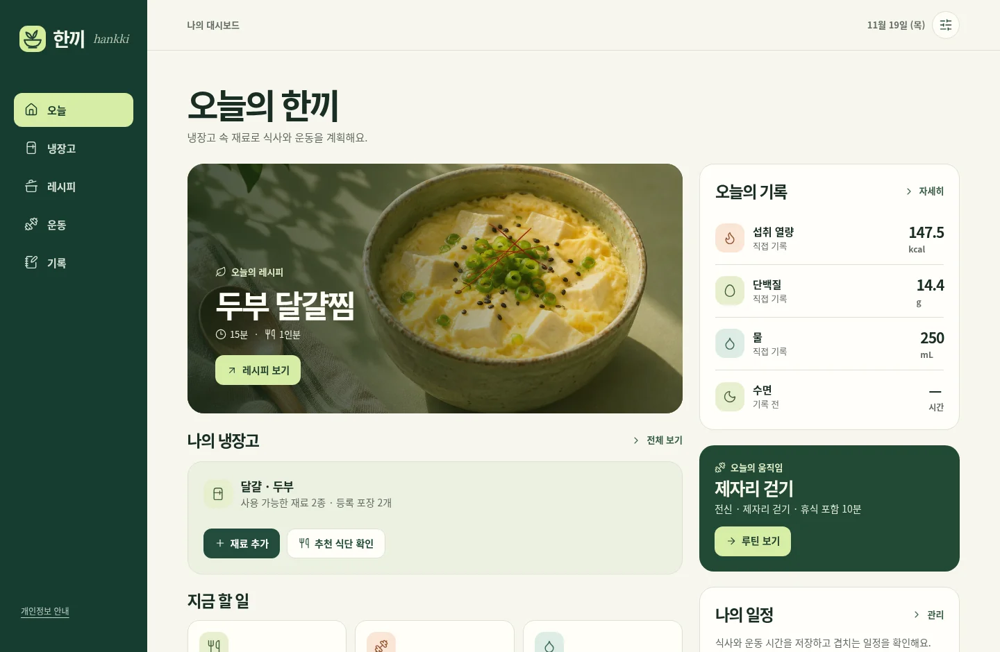
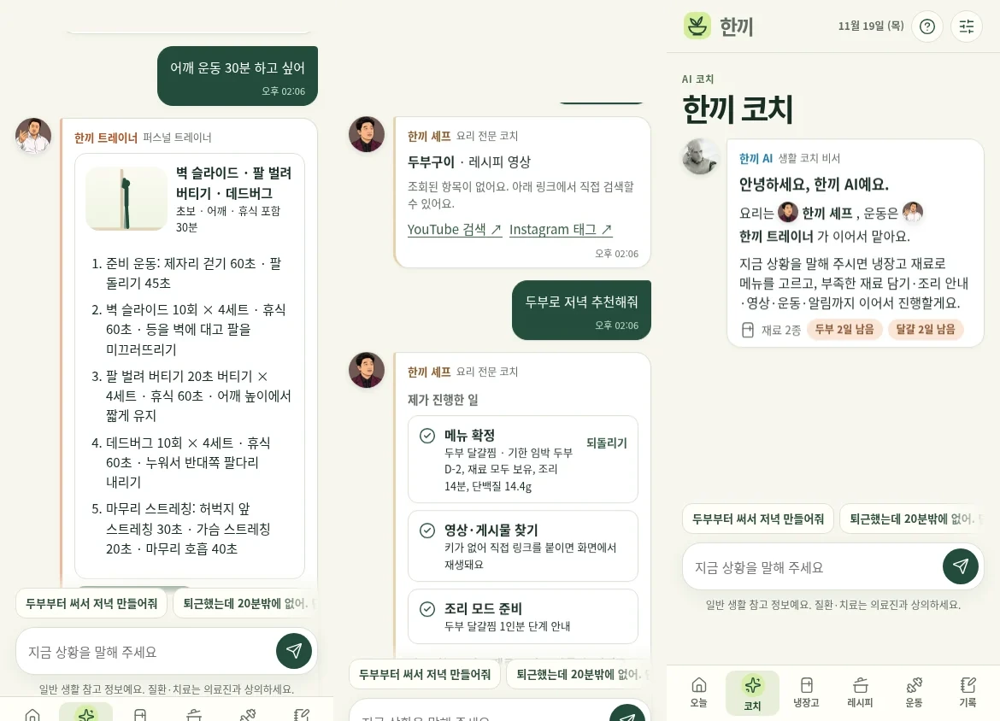

# 한끼 · 냉장고 생활 코치

냉장고 재고(중량·소비기한)를 기준으로 식단·장보기·운동을 추천하는 한국어 Android·웹 앱입니다. 종합 건강관리, 냉장고 털이, 합리적 소비를 한 앱에서 다루는 것이 목표이고, 3회차 과제에서는 그 중심인 Agent를 만들었습니다.

> SSAFY AI 코어 프로젝트 3회차(개인) → 최종 프로젝트로 확장합니다.



[모바일 화면](fridge_agent/screens/today-mobile.webp) · [실행과 키 설정](fridge_agent/README.md) · [요구사항 추적표](fridge_agent/docs/requirements.md) · [설계도](fridge_agent/docs/design.md) · [검증 결과](fridge_agent/docs/validation.md) · [Android APK](android/artifacts/hankki-debug.apk) · [발표자료](fridge_agent/docs/presentation.pptx)

## 실행

```bash
python -m venv .venv && source .venv/bin/activate
```
```bash
pip install -r requirements-dev.txt
```
```bash
cp fridge_agent/.env.example fridge_agent/.env
```
```bash
cd fridge_agent && python app.py
```

`http://127.0.0.1:8000`에서 `추가 두부, 계란`을 입력하면 키 없이도 첫 추천이 나옵니다. `.env`에 `GMS_KEY`를 넣으면 자연어 요청을 모델이 해석하고, 계획을 세우고, 답변 문장을 씁니다.

```bash
python -m pytest
```

## 상황을 말하면 알아서 진행

오늘 화면의 **한끼 Agent** 입력창에 지금 상황을 적으면, 아래 일을 이어서 하고 한 일을 되돌리기 버튼과 함께 보여 줍니다.

| 입력 예 | Agent 가 하는 일 |
| --- | --- |
| 퇴근했는데 20분밖에 없어. 단백질 위주로 | 시간·식단 반영 → 후보 3개(기한 임박 재료·부족 재료·조리시간·단백질 근거) → 1순위 확정 → 영상 찾기 → 조리 모드 준비 |
| 두부 달걀찜 4명이서 먹고 싶어 | 그 메뉴를 1순위로 → 4인분 기준 부족한 두부 100g 장바구니 담기 |
| 둘이 먹을 거고 있는 재료로만 | 장바구니는 건드리지 않음 |

할 일 목록은 규칙이 기본안을 만들고, 모델(GMS)이 있으면 허용된 작업(메뉴확정·장바구니·영상·조리모드)과 인분만 고릅니다. 재고·분량 판단은 코드가 합니다.
`python app.py` 로 켜면 빈 냉장고를 **예시 재료 21가지**(소비기한이 제각각)로 채웁니다(`FRIDGE_DEMO=1`). 냉장고 화면의 "예시 재료로 채우기"로 다시 채울 수 있습니다.
YouTube·Instagram 은 키가 있으면 자동으로 찾고, 키가 없어도 **링크를 붙이면 그 메뉴의 화면 안에서 재생**됩니다.

## 이번 버전에서 달라진 점

- **기본 메뉴 110종과 조합 메뉴 444종, 총 554종**(USDA 영양 참조 56종으로 열량·단백질 계산), 코치 후보를 "바로 가능 · 분량 확인 · 조금만 사면 · 국내 레시피"로 묶어 보여 주고 "다른 후보 알려줘"로 계속 넘겨 보기
- **메뉴·종류로 말하기**: "김치찌개", "파스타", "고기", "국물", "다이어트" 같은 말을 읽어 맞는 레시피를 고름. 시간이 넘는 메뉴는 시간을 늘리고 되돌리기 제공
- **운동 모드**: 실제 시연 사진(10종) 또는 동작 그림, 하는 방법(준비·동작·호흡·주의), 세트·휴식 자동 타이머, 음성, 자세 영상, 다른 선택지(회복 기준·10분·강도 조정)
- **조리 모드**: 단계 사진·영상과 조리 기법별 AI 참고 이미지, 분량 − / +, 단계와 맞는 YouTube 장면 바로 보기
- **첫 실행 튜토리얼**(위쪽 ? 버튼으로 다시 보기)

코치 탭은 한국 시간 기준 오늘 대화로 열립니다. 대화 날짜를 선택하면 이전 문구를 수정하거나 해당 날짜만 지울 수 있습니다. 전체 대화 초기화는 이 브라우저에 저장된 모든 날짜의 코치 대화를 지웁니다.

[새 조리 화면](fridge_agent/screens/cabbage-chopping-mobile.webp) · [날짜별 코치 대화 관리](fridge_agent/screens/coach-history-mobile.webp)

## 냉장고에서 조리까지

- 이름만 등록한 포장은 ‘분량 확인’ 후보에 표시합니다. 냉장고 또는 조리 준비 화면에서 남은 양을 입력하면 같은 포장의 소비기한을 유지하고 부족분을 다시 계산합니다.
- ‘둘이서 있는 재료로만’처럼 요청하면 인분을 적용해 후보를 고릅니다. 조리 화면에서 인분을 바꾼 뒤 부족한 재료만 장바구니에 담을 수 있습니다.
- 레시피 목록에서 메뉴를 찜하거나 최근 조리한 메뉴를 다시 열 수 있습니다. 기록 탭에서는 코치의 추천이 같은 날 실제 조리로 이어진 건수를 추천 당시의 재고 입력 상태별로 볼 수 있습니다.
- 양배추 두부덮밥, 감자 참치전, 사과 아몬드 오트죽, 버섯 렌틸콩 볶음을 추가했습니다. 각 메뉴에 1인분 중량과 단계별 조리법이 있습니다.

[2인분 조리 준비 화면](fridge_agent/screens/recipe-portions-mobile.webp)

## 코치 대화 화면

운동 루틴과 헬스장은 흰 셔츠의 트레이너, 레시피·식단·장보기는 자주색 재킷의 셰프가 담당합니다. 수면·건강 체크·알림과 첫 인사는 로봇 AI가 안내합니다.



## 트레이너 모드 · 구체적인 레시피 · 건강 체크

- **트레이너 모드(운동)**: 숙련도별 처방(초보 10회×2, 중급 12회×3, 숙련 15회×4), 준비 운동 → 본운동 → 마무리 스트레칭. 동작 전 설명(자세 포인트·흔한 실수·쉬운/어려운 변형), 템포에 맞춘 음성 횟수 세기와 자세 교정 멘트, 세트 간 휴식, 동작 후 "어땠어요?"로 다음 동작 강도 조정, 끝나면 체감 난이도를 채운 기록
- **나만의 루틴**: 동작·세트·횟수(버티기 초)·휴식을 골라 저장하고 트레이너 모드로 실행
- **구체적인 레시피**: 재료 준비 단계(g + 큰술·개·모 같은 생활 단위, 재료별 손질법), 단계마다 "이렇게 확인해요" 익힘 기준, 원문에 없을 때 권장 불 세기, 고기 안전 안내, 완성·보관 안내
- **건강 체크(인바디·검진)**: BMI·허리둘레·체지방률·혈압·공복혈당·콜레스테롤·중성지방을 국내 진료지침 기준과 비교(정상·주의·높음), 생활 습관 안내, 질환 의심 범위는 진료 권유. "식단·운동 추천에 반영"을 누르면 나트륨·탄수화물·지방·열량이 낮은 메뉴를 근거와 함께 우선 추천. 진단이 아닌 참고 정보

## 근거 검색 (RAG, F3022)

"단백질 하루 권장량이 얼마야?", "냉동 고기 어떻게 해동해?"처럼 외부 API로 확인할 수 없는 질문은 한끼 안내 문서 31편(영양 섭취기준·식품 안전·운동·생활, 출처 링크 포함)을 Chroma 에서 찾아 근거 문단과 출처를 붙여 답합니다. 관련 근거가 없으면 지어내지 않고 "찾지 못했어요"라고 답합니다.

## Agent 흐름

```
분석(모델: 자연어 → 조건)  →  계획(규칙 핵심 작업 + 모델이 고른 보조 도구, 구조화 출력 Plan)
  →  실행(Worker, 코드)  →  판정(재고·기한·부족 g·시간, 코드)  ⟲ 재계획(최대 3회)
  →  검증(로깅 Agent 이벤트로 이상 징후)  →  응답(모델: 확인된 값만으로 문장)
```

예: “김치찌개 먹고 싶은데 뭐 사야 해?”
1. 모델이 `레시피 김치찌개`로 해석합니다.
2. Planner가 `kr_recipe → naver($부족재료)` 순서를 계획합니다.
3. 코드가 레시피 재료와 냉장고 재고를 비교해, 없는 재료만 쇼핑 검색에 넘깁니다.
4. 모델이 그 결과를 요약합니다.

GMS의 Anthropic Messages API에서 `claude-opus-5-5`로 대화·계획·사진 인식을 처리합니다. 서버의 `fridge_agent/.env`에 `GMS_KEY`를 설정합니다. 등록되지 않은 도구는 코드가 버리고, 모델이 실패하면 규칙 계획으로 계속 진행합니다. 테스트는 대역 모델(`fridge_agent/fake_llm.py`)로 키 없이 돕니다.

[2·3일차 수업별 검증 결과와 재실행 방법](fridge_agent/docs/course-check.md)

## 구조

```
fridge_agent/   한끼 앱: FastAPI(app.py) · LangGraph(workflow.py) · Planner/Worker(agent_roles.py)
                도구 계약(registry.py) · 외부 제공처(food_tools.py, korean_food.py, connections.py)
                도메인(domain/: 재고·조리·장보기·운동) · 모델 연결(gateway.py) · 문서(docs/)
backend/        공통 계층: 이벤트 버스 · 로깅 Agent(LLM 미사용) · SQLite 저장소 · 계획/로그 API
android/        Android 클라이언트 (같은 API 사용)
tests/          공통 계층 테스트
```

## 최종 프로젝트 방향

| 영역 | 기능 | 지금 상태 |
| --- | --- | --- |
| 냉장고 | 재료 분석(소비기한·용량), 먼저 쓸 재료, 냉장고 털이 메뉴 | 구현 |
| 먹고 싶은 음식 | 필요한 재료 나열 → 없는 재료만 쿠팡·네이버 제품 추천 | 구현(Agent 계획). 네이버 쇼핑 API 종료(2026-07-31)·쿠팡 파트너스 승인 여부에 따라 검색 링크로 대체 |
| 다이어트 식단 | 목표별 식단 + YouTube·Instagram 최근 인기 레시피 → 필요한 재료 | 일부(영상·해시태그 조회) |
| 운동 | 목표·부위·숙련도(초보/중급/숙련) 루틴, 카카오맵 헬스장, 나만의 루틴 | 일부(루틴·헬스장) |
| 생활 기록 | 단백질·물·수면 기록, 부족 영양소 안내, Samsung Health·Google Health Connect | 일부(기록, 연동 실기기 미검증) |
| 생체 정보 | 인바디·건강검진 수치 해석과 생활 습관 안내 | 예정. 진단이 아닌 참고 정보로만 안내하고, 기준값은 공개 근거로 표시 |
| 배포 | Google Play 출시 | 예정(AAB 빌드까지 확인) |

일정: 기획 11/25 → 기획 산출물 12/4 → 설계(V-model: 유스케이스 → 시스템 → 아키텍처/ERD/클래스 → 시퀀스) 및 개발 12/17 → 배포 12/21 → 발표 12/23

## 외부 API와 이용 조건

[데이터와 제공처](fridge_agent/docs/data.md)에 출처, 호출 한도, 약관, 라이선스를 정리했습니다. 키는 `.env`에만 두고 커밋하지 않습니다.
