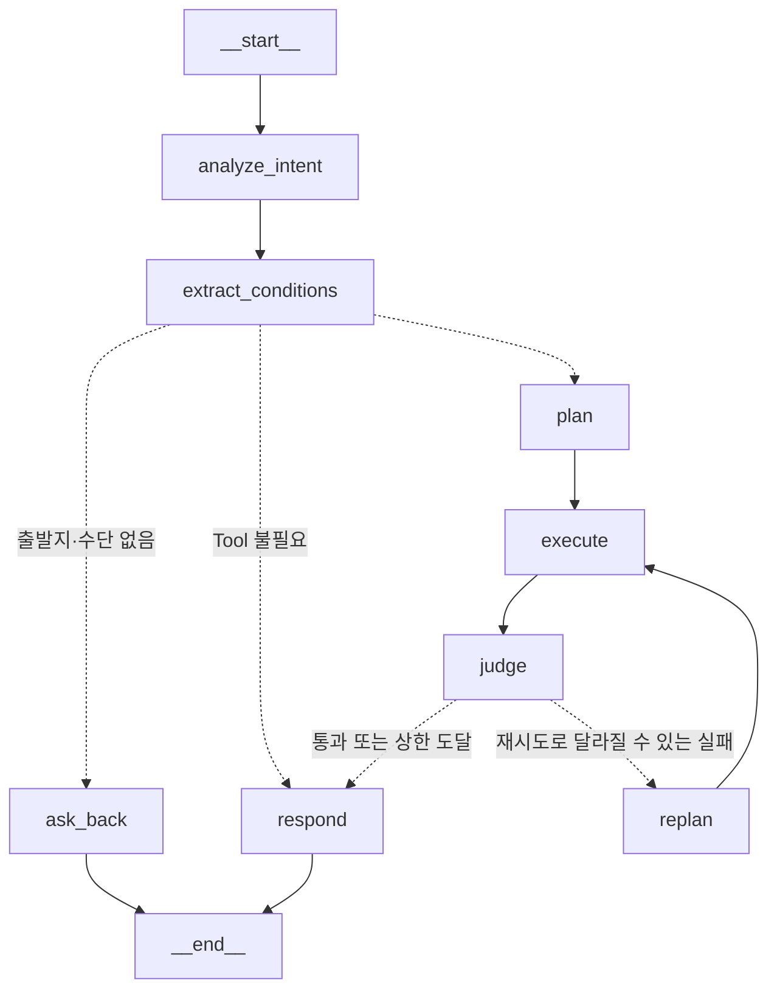

# Agent 설계 (초안)

## 실행 그래프

`python -m backend.agent.graph` 로 출력한 구조입니다.

## 단계별 입출력

| 노드 | 입력 | 출력 | LLM |
| --- | --- | --- | --- |
| analyze_intent | message | intent (plan_trip / route_only / ask_heritage / chitchat) | 사용 (뼈대: 규칙) — 판단과 이유를 이벤트로 |
| extract_conditions | message, 이전 conditions | conditions, missing | 사용 (뼈대: 규칙) |
| plan | intent, conditions | plan (Tool·인자 목록) | 사용 |
| execute | plan, results | results (성공 결과는 재사용) | 사용 안 함 |
| judge | results, conditions | verdict | **사용 안 함 — 코드 판정** |
| replan | verdict | replan_count, 바뀐 plan | 대안 선택에만 사용 |
| respond | 전체 상태 | answer | 문장 생성에만 사용 |

## 재계획 규칙

- 다시 해도 결과가 같은 실패(INVALID_KEY, BAD_ARGUMENT, QUOTA_EXCEEDED, NOT_IMPLEMENTED)는 재계획하지 않고 바로 안내합니다.
- 완화 순서(2일차 구현): 시간 초과 → 가장 먼 장소 제외·교체 / 휴관·휴무 → 같은 지역 다른 장소 / 복귀편 없음 → 다른 수단 / 비 → 실내 위주.
- 상한 3회. 도달하면 멈추고 조건 조정을 되묻습니다.

## 메인 Agent 와 로깅 Agent

메인 Agent 는 `EventBus` 에 이벤트를 발행만 하고, 누가 구독하는지 모릅니다. 로깅 Agent 는 구독해서 SQLite `run_logs` 에 그대로 덧붙입니다(LLM 미사용). 구독자가 실패해도 버스가 예외를 삼켜 대화는 계속됩니다.

## 대화 맥락

세션별로 직전 조건만 보관하고(Tool 원본 응답은 보관하지 않음), 후속 요청에서는 바뀐 조건만 덮어씁니다.
