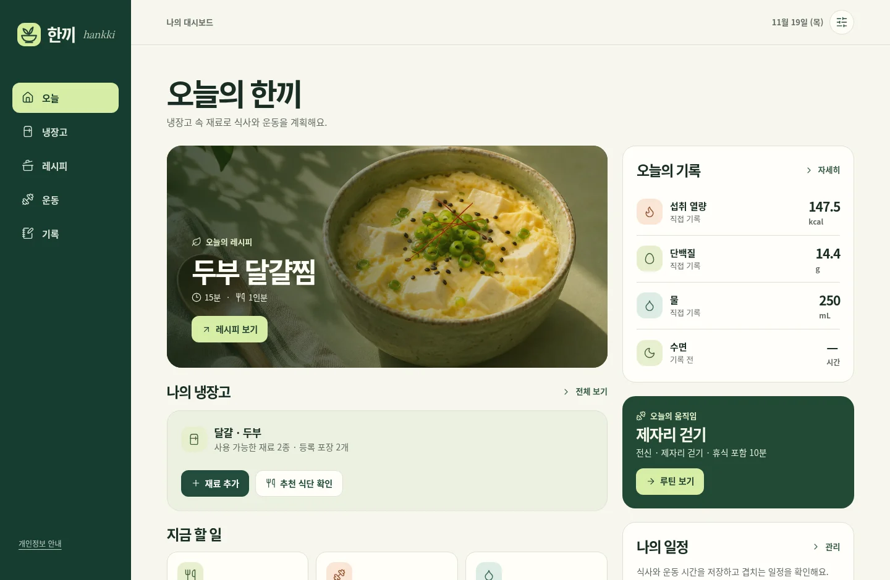

# 한끼 · 냉장고 생활 코치

재료 이름만 등록해도 시작할 수 있는 한국어 앱이다. 기한·중량을 입력하면 오늘 조리할 수 있는 1인분, 부족한 g 수, 조리 후 운동할 수 있는 시간을 계산한다. Android 앱과 모바일·데스크톱 웹에서 같은 기록을 사용한다. 기기 간 계정 동기화는 제공하지 않으며 각 브라우저에는 별도의 개인 공간을 발급한다.

[모바일 첫 화면](screens/today-mobile.webp) · [냉장고](screens/pantry-mobile.webp) · [추천과 근거](screens/meal-mobile.webp) · [운동](screens/workout-mobile.webp) · [생활 기록](screens/journal-mobile.webp) · [장바구니](screens/shopping-desktop.webp) · [실행 이력](screens/trace-mobile.webp)

## 실행

Python 3.12에서 저장소 루트를 기준으로 실행한다.

~~~bash
cd fridge_agent
python -m venv .venv
source .venv/bin/activate
python -m pip install -r requirements.txt
cp .env.example .env
python app.py
~~~

브라우저에서 http://127.0.0.1:8000 을 열고 ‘재료 추가’를 누른다. Windows에서는 활성화 명령으로 `.venv\Scripts\activate`를 사용한다. 터미널에서 실행할 때마다 같은 FRIDGE_DATA_DIR를 사용하면 기록이 유지된다. 키 없이 식단·운동·생활 기록과 로컬 캘린더를 사용할 수 있다. API 설명은 실행 중인 서버의 /docs 에서 확인한다.

| 해 볼 일 | 앱에서 확인할 결과 |
|---|---|
| 두부 300g과 달걀 3개 등록 | 알려진 중량과 소비기한 순서, 달걀 1개 ≈ 50g 환산 |
| ‘두부 달걀찜’ 선택 | 1인분 두부 100g·달걀 50g, 15분, 약 148kcal·단백질 14.4g |
| 2인분 조리, 1인분 섭취 | 두부 100g·달걀 50g 재고, 남은 음식 1인분, 섭취 영양 1인분 |
| 김치볶음밥 선택 후 부족분 담기 | 필요한 g을 장바구니에 저장. 상품 비교와 구입 후 입고, 부분 구입 잔량 처리 |
| 운동 목표·부위·숙련도 설정 | 휴식 포함 루틴과 체감 난이도 피드백, 지역별 헬스장 |
| 기록 화면에서 물·수면 입력 | 날짜별 합계와 출처, 지정한 개인 영양 목표의 남은 양, 7일 기록 |

## 에이전트와 데이터

Planner가 필요한 작업을 만들고 Worker가 도구를 순서대로 실행한다. 독립 로깅 Agent가 노드·도구·결정·오류·재계획을 저장하고 검사한다. 식재료 판단에는 USDA 식품 기준 25개, 직접 구성한 레시피 16개와 wger 운동 참조 8개를 SQLite에 적재한다.

`GMS_KEY`와 발급 계정에 허용된 `GMS_MODEL`을 서버의 .env에 설정하면 자유 문장과 조건부 Worker/Logger 모델 경로가 열린다. 예를 들어 “냉장고에 두부와 달걀이 있어. 20분 안에 뭘 먹을까?”처럼 요청한다. 명시한 시간과 재고만 변경한다. 식품안전나라 COOKRCP01와 공공데이터포털의 식약처 식품영양성분 키는 각각 `FOODSAFETY_API_KEY`, `DATA_GO_KR_SERVICE_KEY`다. 쇼핑·지도·영상·캘린더·RAG까지 포함한 설정은 [데이터와 제공처](docs/data.md)에 정리했다.

| 한국어 요청 예시 | 동작 |
|---|---|
| 추가 두부, 계란 / 시간 30 / 추천 | 냉장고·시간 반영 |
| 메뉴 대파 달걀볶음 / 대체 양파 | 허용한 재료 대체와 조리 안내 변경 |
| 레시피 달걀찜 / 식품영양 두부 | 국내 원문과 기준량 확인. 원문에 없는 분량·시간은 직접 확인 후 개인 레시피에 담기 |
| 요리코치 달걀찜 / 계란 / 3017620422003 | 국내 레시피·재료 영양·대안 후보·바코드를 한 요청에 조합 |
| 쇼핑 두부 / 영상 두부 달걀찜 / 헬스장 강남역 | 제공처의 상품·최근 레시피·주변 운동 장소와 직접 검색 |
| 외식 / 집밥 / 주간계획 | 당일 일정 변경이나 7일 식단과 운동 초안 |
| 물 250 / 수면 7.5 / 조리 2인분 14분 / 섭취 두부 달걀찜 | 기록 및 다음 추천 갱신 |
| 해설 불국사 / 일정조회 2026-12-17 / 일정등록 1 | 2회차 Chroma 문서 검색, 캘린더 조회, 저장 계획 ID로 등록 |

## 설계와 검증

- [F3001~F3023 및 NF3001~NF3007 추적표](docs/requirements.md)
- [V 모델과 유스케이스·시스템·ERD·클래스·시퀀스 설계](docs/design.md)
- [도구 계약](docs/tools.md) · [FastAPI OpenAPI 명세](docs/openapi.json)
- [검증 결과와 분석가 포트폴리오 해석](docs/validation.md) · [대표 요청의 전체 로그](docs/evidence/one-run.json)
- [발표자료 PPTX](docs/presentation.pptx) · [배포와 DB 관리](docs/deployment.md)
- [Android 프로젝트와 실행 안내](../android) · [디버그 APK](../android/artifacts/hankki-debug.apk) · [미서명 AAB](../android/artifacts/hankki-unsigned.aab)

저장소 루트에서 `python -m pip install -r requirements-dev.txt` 후 `python -m pytest`로 테스트한다. `python fridge_agent/validate.py --live`는 공개 API 실호출과 임시 가구에서의 고정 시나리오를 재실행해 증거를 갱신한다. 브라우저 검증은 `pip install playwright pillow` 후 `playwright install chromium`, 이어서 `python fridge_agent/system_check.py`로 실행한다. 이미 설치된 Chromium은 `--chromium /usr/bin/chromium`으로 지정한다. `--screens <디렉터리>`를 주면 실제 실행 화면을 저장한다.

실제 GMS 응답, 인증이 필요한 국내·쇼핑·콘텐츠 제공처, 실기기 건강 권한, 실제 Google 캘린더, Play 출시 상태는 [검증 범위](docs/validation.md)에서 확인할 수 있다.
